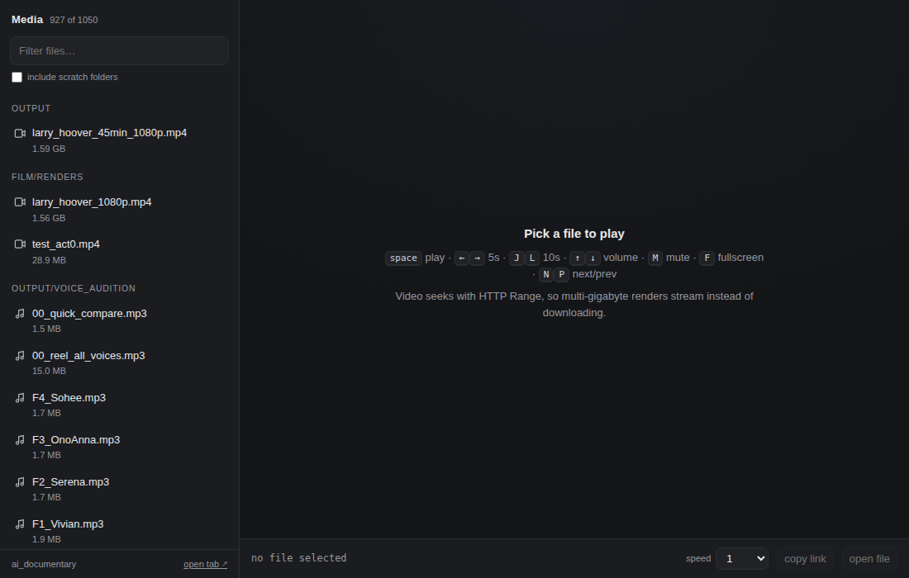

# dsh-media-player

A video/audio player for the [DeepSeek Harness](https://github.com/deepseek-ai/deepseek-harness) Web panel.

Click a media file in the Sidebar and it plays in place. A 45-minute 1080p master
streams with HTTP `Range` and seeks instantly instead of being read into memory —
the same trick that makes a 1.7 GB render usable in a browser.



## Why this exists

The Sidebar's document preview reads whole files over RPC: right for a PDF, hopeless
for a video master. This plugin adds two things the preview lacks:

- **A loopback HTTP server** that answers `Range` requests, so the browser fetches
  only the bytes it plays. It lives inside the harness process, so it starts and
  stops with `dsh web` and cannot outlive it as an orphan.
- **A document-preview renderer** for video and audio, so a media file no longer
  falls through to "preview is not available".

## Install

Requires a DSH Web profile (built against `@deepseek-ai/dsh` 0.2.0-rc.2).

1. Clone somewhere stable and absolute:

   ```sh
   git clone https://github.com/magnoliatech-code/dsh-media-player.git ~/.local/share/dsh-media-player
   ```

2. Add the plugin entry to the profile patch, `~/.dsh/profiles/web/cordis.patch.yml`:

   ```yaml
   - insert:
       - id: media-player
         name: /home/YOU/.local/share/dsh-media-player/index.js
         config:
           root: /home/YOU/projects        # what the playlist scans
           port: 8099
   ```

   Two constraints, both easy to trip over:

   - A new entry needs an **`insert:` list**. A bare `- id: …` only *overrides* an
     entry that already exists; alone it warns `patch: entry "…" not found` and
     loads nothing.
   - `name` must be an **absolute path**. The loader rewrites it to a `file://` URL,
     so there is no `pnpm add`, no profile dependency, and no build step.

3. Restart the harness (`dsh web`) and reload the page. **Code changes need a
   restart; config changes do not** — editing the patch restarts the entry in about
   two seconds, but Node caches imported modules, so new code only loads with a new
   process.

## Configuration

| Field | Default | Meaning |
| --- | --- | --- |
| `root` | `process.cwd()` of the harness | Directory scanned and served |
| `port` | `8099` | Loopback TCP port |
| `host` | `127.0.0.1` | Bind address |

Pin `root` rather than relying on the launch directory if you start `dsh web` from
somewhere else.

## Use it

- **In the harness** — click a media file in Files, or a chat link to one. The tab
  shows the path header, reload, and open-in-app as usual.
- **The full page** — right Sidebar → **Browser** → `http://127.0.0.1:8099/`. The
  shipped Browser tab is off by default in Web profiles; enable it with
  `- id: ui-sidebar-browser` and `disabled: false` in the same patch file.
- **Outside** — open the same URL in any browser; it is not tied to a session.
- **Standalone, harness stopped** — `node bin/media-player.js --root DIR --port N`.

### Deep links

`#play=<path>` opens the player on one file. The path may be relative to the served
root or absolute, and selecting a file in the UI rewrites the fragment, so the
address bar is always shareable:

```
http://127.0.0.1:8099/#play=renders/act1.mp4
http://127.0.0.1:8099/#play=/home/you/projects/renders/act1.mp4
```

Browsers refuse unmuted autoplay without a gesture, so arriving through a link shows
a **press to play** gate over video. Audio keeps its native controls instead — a gate
there is just clutter. The linked file stays listed whatever filter is active.

## How it works

**Host** (`index.js`, `server.js`) owns the loopback listener and publishes its
address into the page as `globalThis.dshMediaPlayer` through the webserver's
`index-inject` event, so the browser half never guesses a port.

**Client** (`lib/client.js`) claims `mp4 m4v mov webm mkv ogv mp3 m4a aac wav flac
ogg opus weba` at the `extension` priority band and renders the player body. It
registers with `loading: 'renderer'`, which means the shared preview never reads the
file: the body asks `/api/resolve` for a stream URL and hands it to the browser's own
`<video>`/`<audio>`.

The client half is a hand-written bundle — the harness loads it through
`window.__ModuleLoader__`, and `react` is the only platform module it requests. No
bundler, no build step; edit `lib/client.js` and reload the page.

### Endpoints

| Path | Purpose |
| --- | --- |
| `/` | Player page |
| `/api/media` | Playlist JSON for the whole root |
| `/api/health` | Liveness, bound port, root |
| `/api/resolve?address=…` or `?path=…` | Resource address or path → stream URL |
| `/m/<path>`, `/<path>` | Media with `Range` support |

## Security

Loopback only by default. Only media and subtitle suffixes are served, so source
files and secrets under `root` answer 404. Requests whose `Host` header is not the
loopback name plus the bound port are rejected, which defeats DNS rebinding. JSON
endpoints reflect `Origin` only for loopback origins, so the harness page on another
local port can read them while a public site cannot.

It runs as your user, never root: the harness is your process.

## Limitations

- **Code changes need a harness restart**, as above.
- **One owner per port.** A second `dsh web` instance logs
  `media-player: 127.0.0.1:8099 is already in use` and keeps everything else working.
- **The browser decides what it can decode.** `.mkv` and Theora are claimed but often
  refused by Chromium; the player says so and points at VLC rather than showing a
  dead frame.
- **Fullscreen is blocked** inside the sandboxed Sidebar Browser frame; use
  `open tab ↗`, or the preview renderer, where the player is not framed.

## Development

```sh
npm test        # node test/smoke.mjs
```

The smoke test loads the bundle the way the harness does and checks the renderer
registration, the video/audio render trees, stream URLs, the decode-failure overlay,
and the retry state. History is tagged `v0.1.0` … `v0.2.1`; see
[CHANGELOG.md](CHANGELOG.md).

`private: true` in `package.json` is deliberate — this is installed from a path, not
published to npm.

## License

MIT
